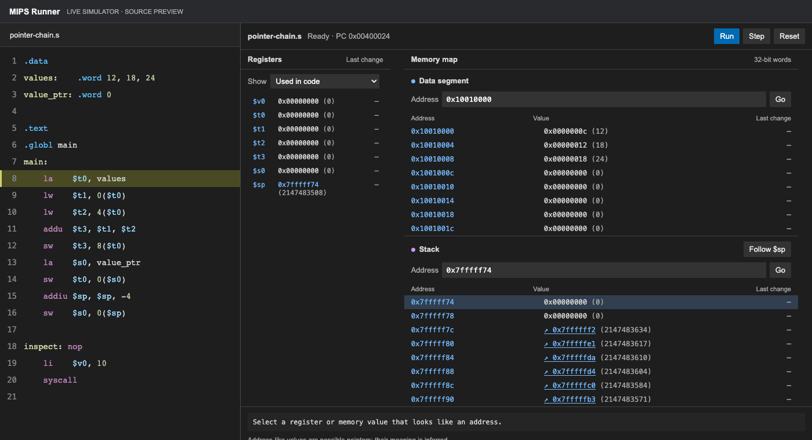
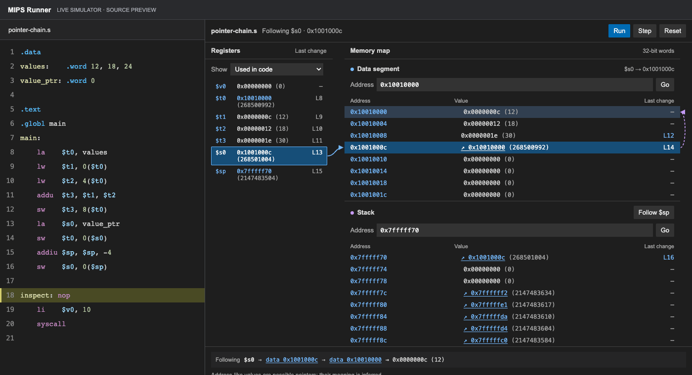

# MIPS Runner

Extension VS Code pour exécuter et inspecter du code assembleur MIPS avec le moteur SPIM de JsSpim, inclus au format WebAssembly. Aucune installation de MARS ou de Java n'est nécessaire.

## Démonstration

### Exécuter pas à pas

Les registres et la mémoire évoluent à chaque instruction. La colonne **Last change** indique la dernière ligne ayant modifié une valeur.

### Suivre les pointeurs

Sélectionnez un registre ou une adresse pour visualiser le chemin entre la pile et les données. Ces animations utilisent le simulateur et la vue MIPS Runner ; le code à gauche est présenté dans un aperçu dédié.

Le code utilisé est disponible dans [examples/pointer-chain.s](examples/pointer-chain.s).

## Installation

Pour installer une version téléchargée depuis GitHub :

1. Télécharger le fichier `.vsix` de la version souhaitée depuis les [releases GitHub](https://github.com/JSchoreels/MIPS-Runner/releases).
2. Dans VS Code sur ordinateur, ouvrir la vue **Extensions**, puis le menu **…** et sélectionner **Install from VSIX…**.
3. Choisir le fichier téléchargé et recharger VS Code si nécessaire.
4. Ouvrir un fichier MIPS : il est chargé automatiquement dans MIPS Runner.

L'extension est aussi disponible sur le [VS Code Marketplace](https://marketplace.visualstudio.com/items?itemName=Jisko.mips-runner), ou depuis la vue **Extensions** de VS Code en recherchant **MIPS Runner** par **Jisko**.

Si une version de développement `local.mips-runner` est déjà installée, la désinstaller avant d'installer `Jisko.mips-runner` pour éviter que les deux extensions ne soient actives en même temps.

## Démarrer en développement

1. Ouvrir ce dossier dans VS Code.
2. Appuyer sur **F5** pour démarrer une fenêtre de développement de l'extension.
3. Dans cette fenêtre, ouvrir un fichier MIPS, par exemple `examples/pointers.s`.
4. Le panneau **MIPS Runner** charge automatiquement le fichier actif. Utiliser **Step** ou **Run** pour exécuter le programme.

Le contenu actuel de l'éditeur est utilisé, y compris les modifications non enregistrées. Après une modification, l'exécution est suspendue : **Run**, **Step** ou **Reset** assemble automatiquement la nouvelle version et redémarre le programme. Les points d'arrêt VS Code sont conservés.

Les fichiers `.s`, `.asm` et `.mips` utilisent la coloration syntaxique MIPS. Si une autre extension prend en charge le même type de fichier, sélectionner **MIPS** dans le sélecteur de langage en bas à droite de l'éditeur.

Quand un fichier MIPS devient actif, l’extension le charge par défaut. Le réglage **MIPS Runner: Open Behavior** permet de choisir `ask` (proposer), `auto` (charger automatiquement) ou `manual` (utiliser la commande manuelle). Une proposition ignorée ne réapparaît pas tant que le fichier reste ouvert. Le fichier déjà chargé n’est pas réinitialisé lorsqu’on revient sur son onglet ; passer à un autre fichier MIPS charge ce dernier.

## Utilisation

- Ouvrez un fichier MIPS et appuyez sur **F5** pour le lancer avec **Run and Debug** ; choisissez **MIPS Runner** si VS Code le demande. Le fichier actif est assemblé automatiquement. Placez les points d'arrêt directement dans la marge de l'éditeur : les commandes de débogage et la carte mémoire utilisent le même simulateur. Les points d'arrêt de la marge fonctionnent également avec **Run** dans le panneau MIPS Runner.
- Utilisez **Run Without Debugging** pour exécuter le fichier actif sans vous arrêter aux points d'arrêt. La sortie est disponible dans la console de débogage et dans MIPS Runner.
- Les boutons **Step Over** et **Step Into** avancent d'une instruction machine. **Step Out**, les points d'arrêt conditionnels et les logpoints ne sont pas encore pris en charge. Si le fichier change pendant une session de débogage, relancez la session pour assembler sa nouvelle version.
- Pour placer MIPS Runner à droite, afficher la barre latérale secondaire avec **View: Toggle Secondary Side Bar Visibility**, puis y glisser l'onglet **MIPS Runner**. Pour le replacer en bas, le glisser vers le panneau inférieur. L'exécution et les points d'arrêt sont conservés pendant le déplacement.
- Le filtre des registres propose **All registers**, **Used in code** (registres mentionnés dans les instructions du fichier chargé, sans compter les commentaires ou les chaînes) et **Accessed during execution**. Ce dernier mode utilise les lectures et écritures enregistrées par le simulateur, y compris pendant les appels système ; il est remis à zéro après **Reset** ou un nouvel assemblage. La liste défile si nécessaire.
- Dans la section **Watch** de VS Code, saisissez un registre comme `$t0`, `$s1` ou `$8`, ou `PC`, pour voir sa valeur pendant une pause du débogueur. **Run** et **Step** dans MIPS Runner démarrent une session de débogage si nécessaire, en conservant l'état du programme. Les expressions arithmétiques ne sont pas encore prises en charge.
- Les registres et les segments **data** et **stack** restent visibles ensemble dans la carte mémoire. Cliquer sur un registre contenant une adresse de ces segments pour mettre en évidence la case correspondante et suivre les éventuels pointeurs qu'elle contient. Les liens visibles sont tracés dans le panneau ; le résumé conserve le chemin complet même si certaines adresses sont hors écran.
- Dans le fichier chargé, cliquer sur un registre ou une étiquette de données pour le mettre en évidence dans le panneau. Dans l'autre sens, cliquer sur un registre ou une adresse mémoire du panneau pour mettre en évidence ses références dans le fichier ; les alias numériques des registres sont reconnus. Pour la mémoire, seules les étiquettes résolues à cette adresse exacte sont mises en évidence.
- Cliquer sur une valeur mémoire ressemblant à une adresse pour suivre son propre chemin, ou sur une adresse du résumé pour l'afficher dans son segment. Le chemin s'arrête sur une valeur ordinaire, un cycle, une adresse non alignée ou après huit cases ; une adresse non alignée est montrée dans le mot qui la contient sans être interprétée comme un mot complet.
- Les formulaires **Address** acceptent une adresse hexadécimale et affichent les mots de 32 bits à partir de l'adresse alignée correspondante. Les valeurs des registres et de la mémoire sont affichées en hexadécimal, suivi du décimal signé entre parenthèses, par exemple `0x0000000c (12)`. **Follow $sp** reprend le suivi du pointeur de pile.
- Les valeurs modifiées sont mises en évidence après un pas. La colonne **Last change** indique la dernière ligne ayant effectivement changé chaque registre ou mot mémoire, même pendant **Run** : survoler la ligne pour voir l'instruction, puis cliquer sur le registre, l'adresse ou le numéro de ligne pour la retrouver dans l'éditeur. Un tiret indique qu'aucun changement n'a été enregistré depuis l'assemblage ; réécrire la même valeur ne remplace pas la dernière modification. L'initialisation et la routine de démarrage ne sont pas comptées. **Reset** et les nouveaux assemblages effacent cet historique.
- La prochaine instruction à exécuter est surlignée dans l'éditeur, avec une flèche dans la marge. Le surlignage disparaît si le code change ou lorsque le programme est terminé. Un pas exécute une instruction machine : une pseudo-instruction peut donc rester surlignée pendant plusieurs pas. Lors de l'assemblage, la routine de démarrage SPIM habituelle est exécutée jusqu'à `main` avant le premier pas.
- Au survol d’une instruction courante, une infobulle explique son rôle et son format d’opérandes. Elle propose aussi un lien vers le manuel SPIM. Les noms d’opérandes de l’infobulle sont des exemples de paramètres, pas des noms de registres à saisir.
- Pendant la saisie, SPIM vérifie la syntaxe du fichier MIPS et affiche ses erreurs dans l’éditeur et dans **Problems**. Cette vérification ne modifie pas l’état de l’exécution en cours et ne nécessite pas d’ouvrir le panneau du simulateur.
- **Reset** redémarre l'exécution en conservant les points d'arrêt de VS Code.
- Pour un programme qui lit l'entrée standard, saisir les lignes dans **Standard input**, puis cliquer sur **Reset** avant l'exécution. La sortie et les messages du simulateur apparaissent dans **Output and SPIM log**.

## Limites actuelles

- Il s'agit d'une première version pour VS Code sur ordinateur. La version web de VS Code n'est pas encore prise en charge.
- Les infobulles couvrent les instructions MIPS et pseudo-instructions courantes, pas encore toutes les instructions SPIM. Le validateur utilise l’assembleur SPIM : il signale généralement la première erreur de syntaxe, mais ne vérifie pas tous les problèmes d’exécution ni les étiquettes non définies.
- Les points d'arrêt ne concernent que le fichier MIPS chargé. Les points d'arrêt conditionnels, les logpoints et **Step Out** ne sont pas encore pris en charge ; un point d'arrêt doit correspondre à une ligne contenant une instruction.
- L'entrée standard est préparée à l'avance ; la saisie interactive en cours d'exécution n'est pas encore prise en charge.
- Le runtime utilise un système de fichiers virtuel distinct des fichiers du projet. Les appels système sur des fichiers n'accèdent pas directement au dossier VS Code.
- Le moteur SPIM actuel n'expose qu'une vue limitée de la pile. Si cette dernière grandit au-delà de cette vue, l'extension masque les valeurs de pile et affiche un avertissement plutôt que des données potentiellement incorrectes.
- Les valeurs associées aux registres ou à la mémoire sont proposées comme pointeurs possibles lorsqu'elles appartiennent à un segment affichable : une valeur numérique peut correspondre à une adresse sans être un pointeur intentionnel. Le nom d'une étiquette de données sélectionnée dans l'éditeur est affiché avec son adresse ; les noms ne sont pas affichés automatiquement pour toutes les cases mémoire.

## Moteur et provenance

Le répertoire `vendor/spim` contient le code SPIM issu de JsSpim, révision `64ddfacb70ccd5a63469d34a76eda109d5a820d2`, modifié pour enregistrer les lectures et écritures de registres ainsi que la dernière instruction ayant modifié un registre ou un mot mémoire. Le WebAssembly inclus a été reconstruit depuis ces sources avec Emscripten 3.1.64 ; le Makefile fournit la reconstruction avec Emscripten, flex et bison. L'extension fonctionne sans compilation préalable ni dépendance à un dépôt voisin. Les informations de licence sont reprises dans [THIRD_PARTY_NOTICES.md](THIRD_PARTY_NOTICES.md).

Le projet n'a pas encore de licence propre. L'identifiant de l'extension est `Jisko.mips-runner`.
